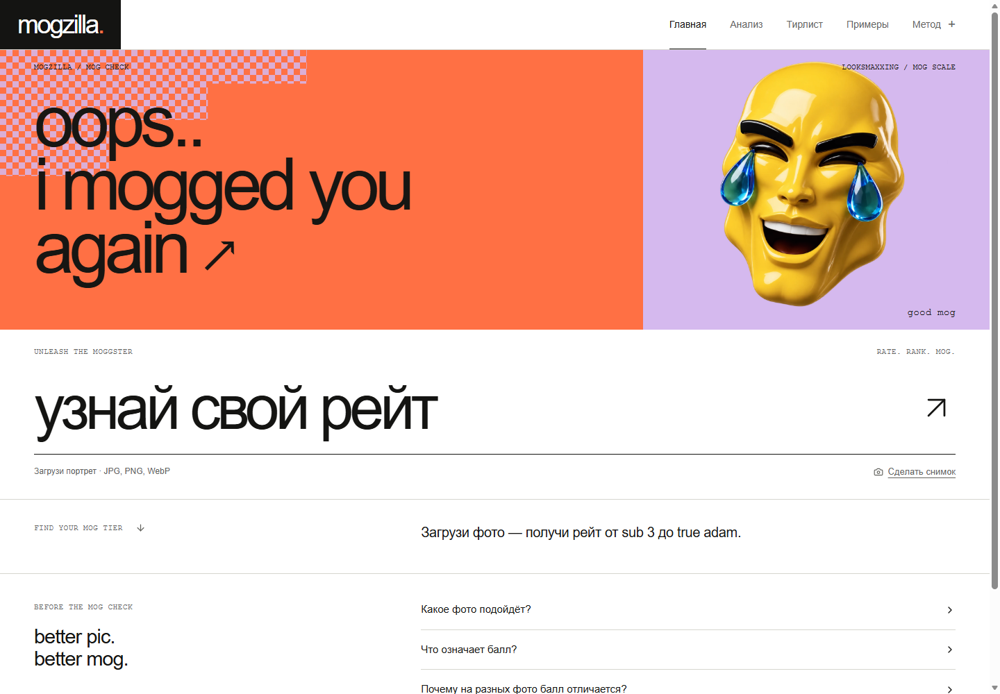
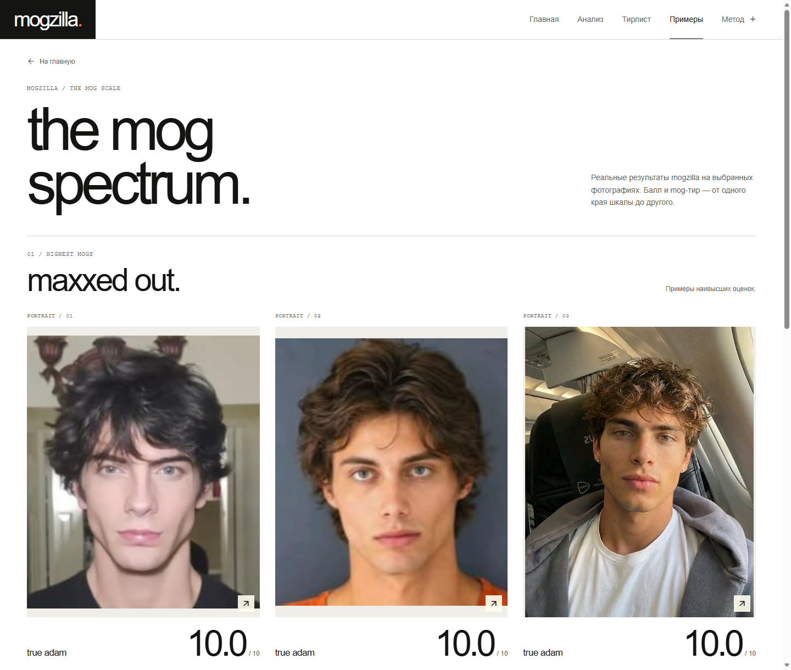

[English](README.md) | **Русский**

# mogzilla

**[Открыть Mogzilla](https://mogzilla.2-27-32-143.sslip.io/)**

Приложение на Python для оценки портретов: балл от 1 до 10 в эстетике looksmaxxing, 478 ключевых точек лица и интерактивный разбор восьми областей. Можно загрузить фотографию или использовать камеру, изучить измерения и формулы, посмотреть примеры от **sub 3** до **true adam**.

Светлый интерфейс оформлен с крупной типографикой и анимированным персонажем, который реагирует на результат. Изображение обрабатывается Python-сервером; на опубликованном сайте фотографии остаются в оперативной памяти сервера. Интерфейс на русском языке.

## Скриншоты

**Главная страница**



**Галерея примеров с оценками**



## Что такое looksmaxxing

**Looksmaxxing** — интернет-культура улучшения внешности через уход, стиль и другие изменения. В мужских сообществах часто ориентируются на модельную эстетику и используют собственные термины для пропорций лица и общего образа. Это предпочтения сообществ, а не универсальный или научно установленный стандарт красоты. Их контекст описан в [исследовании сообщества](https://doi.org/10.1177/1357034X251363787).

Часто обсуждаются следующие признаки:

| Область | Что обычно ценят в этих сообществах |
| --- | --- |
| Глаза и брови | Миндалевидные или прикрытые «hunter eyes», нейтральный или положительный наклон внешнего уголка, низко расположенные выраженные брови |
| Челюсть и подбородок | Выраженный контур челюсти, сбалансированный выступающий подбородок |
| Скулы и пропорции | Заметные скулы и сбалансированные соотношения областей лица |
| Гармония и симметрия | Сочетаемость черт и небольшая видимая асимметрия |
| Общий вид | Внешне чистая кожа, ухоженные волосы и аккуратный образ |

mogzilla использует эту лексику для оформления и названий категорий. Эстетические категории субъективны. Приложение не определяет ценность человека, здоровье, процент жира или пригодность к работе моделью.

## Возможности

- Загрузка фотографии, перетаскивание файла и съёмка с переключением передней и задней камеры.
- Балл, название категории и реакция персонажа.
- Восемь интерактивных областей: глаза, брови, верхняя и средняя части лица, нос/рот, челюсть/подбородок, симметрия, кожа/освещение.
- Наложение ключевых точек, измеренные отрезки, формулы и объяснения на уровне координат.
- Технические проверки размера лица, позы, обрезки, размытия, освещения и закрытых глаз.
- Проверка чувствительности к обрезке и отражению, экспорт JSON без фотографии.
- Галерея примеров через **Examples** в верхней навигации и постер главной страницы.

## Данные и разметка

Дополнительные оценки портретов предоставлены как **оценки модельных скаутов по шкале 1–10**. Это отдельная разметка, отличная от исходных средних оценок участников в датасетах. Доступные выгрузки не подтверждают согласованность оценок представительной группы скаутов.

| Источник | Роль |
| --- | --- |
| [SCUT-FBP5500](https://github.com/HCIILAB/SCUT-FBP5500-Database-Release) | Портреты с человеческими оценками для исходной модели |
| [MEBeauty](https://huggingface.co/datasets/dr-irina-lebedeva/MEBeauty-Facial-Beauty-Prediction) | Дополнительные фотографии с проектной разметкой скаутов |
| [Коллекция портретов Pinterest](data/README.md) | Предоставленные digitals и другие портреты с подтверждёнными оценками скаутов; отдельный архив |
| [WFLW](https://github.com/wywu/LAB) | Исходное обучение модели ключевых точек и технический аудит геометрии |
| [AFW / 300-W](https://ibug.doc.ic.ac.uk/resources/300-W/) | Ранний эксперимент с 68 точками на подмножестве AFW |
| [WIDER FACE](http://shuoyang1213.me/WIDERFACE/) | Дополнительные данные детекции лиц в прежней версии |

WFLW, AFW и WIDER FACE не содержат целевых оценок привлекательности для текущего балла. Архив Pinterest не включает фотографии исследовательских датасетов. Права на сторонние фотографии сохраняются за их владельцами; общедоступность репозитория не означает свободную лицензию на изображения.

## Получение результата

Python декодирует фотографию, находит лицо, проверяет техническую пригодность и вычисляет визуальный балл по обрезкам лица и более широкой области головы. Геометрия по ключевым точкам считается отдельно. Измерения описывают фотографию, но не объясняют причинно балл нейросети.

Ревизия текущего обученного профиля — `33c59a04cba4`. Репозиторий содержит его оценочную голову и обновлённый визуальный блок. При настройке скачиваются закреплённые исходные модели с проверкой SHA-256. Происхождение, предобработка, хеши и ограничения описаны в [отчёте о модели](reports/SCORING.md).

Категории — заданные в проекте интервалы отображаемого балла, а не процентили или отдельный классификатор. Диапазон результатов обрезок показывает чувствительность одной фотографии, а не доверительный интервал.

## Валидация

Для оценки использованы **717 фотографий обучения и 200 отложенных фотографий**. На отложенной выборке MAE составляет **1.20 балла из 10**; **51%** предсказаний отличаются от разметки не более чем на один балл.

Оценка ограничена: часть отложенных результатов просматривалась в ранних экспериментах, полное разделение по людям не подтверждено, пересечение с исходными датасетами не исключено. Небольшая отобранная коллекция не подтверждает точность ранжирования для любых портретов. Подробности — в [отчёте о модели](reports/SCORING.md) и [аудите геометрии](reports/HOLISTIC.md).

## Локальный запуск

Нужны **Python 3.12**, **Node.js 22.12+** и **pnpm**. Скрипты также могут найти встроенные среды Codex в Windows.

```powershell
git clone https://github.com/selecteg12/mogzilla.git
cd mogzilla
git switch codex/holistic-rating
.\setup.ps1
.\start-mogzilla.ps1
```

Откройте **http://127.0.0.1:8008**. Остановка — `Ctrl+C`. Обученный профиль загружается из `training/checkpoints/holistic`; настройка скачивает туда около 98 MB исходных моделей. Версии закреплены в `requirements-lock.txt` и `frontend/pnpm-lock.yaml`.

Для разработки интерфейса запустите `start.ps1 -Port 8001`, затем `pnpm dev` в `frontend/`. Прокси разработки направлен на порт 8001. Прежняя реализация FaceMetrics остаётся в ветке `master`.

## Проверки

```powershell
.\.venv\Scripts\python.exe -X utf8 -m pytest -q --basetemp=.test-tmp
cd frontend
pnpm test:camera
pnpm test:rating
pnpm test:regions
pnpm build
```

Тесты с недоступными исследовательскими образцами пропускаются при их отсутствии. Скрипты `training/` относятся к ранним экспериментам с ключевыми точками и детекцией; `scripts/` — к подготовке, обучению и оценке текущего профиля.

## История размещения на Vercel

Предыдущая версия работала в проекте Vercel `facemetrics-ai`. Интерфейс и Python API обслуживались с одного адреса через **`Dockerfile.vercel`**. В контейнер входили CPU PyTorch и нативные библиотеки MediaPipe.

В этом размещении использовалась ревизия модели: **`33c59a04cba4`**. Сборка сделана из коммита [`c7e2f1d`](https://github.com/selecteg12/mogzilla/commit/c7e2f1d3dab9294b577a1cb659fe7b09729e38f6). Проверки публичного API и загрузки через браузер прошли: опубликованный пример вернул **10.0 / true adam**, **478 точек** и **восемь областей**.

```powershell
# Проверить локальную сборку и ревизию модели
.\.venv\Scripts\python.exe -X utf8 -m scripts.serve_mogzilla --check

# Команда проверки прежнего размещения на Vercel
.\.venv\Scripts\python.exe -X utf8 -m scripts.check_mogzilla_deployment https://facemetrics-ai.vercel.app
```

Для проверки этого размещения использовался портрет из публичной галереи. Команды для контейнера и подробности выпуска приведены в [заметках о размещении](reports/DEPLOYMENT.md).

## Структура проекта

```text
backend/       FastAPI, нейросетевая обработка, геометрия и тесты
frontend/      React + TypeScript, персонаж и галерея
training/      Обучение и выбранные файлы модели
data/          Архив Pinterest и сведения об источниках
scripts/       Настройка, оценка, разметка и запуск
reports/       Данные, эксперименты и ограничения
tools/         Локальный инструмент разметки портретов
```

## Приватность и исследовательское использование

Загруженные фотографии обрабатываются в памяти. Приложение не сохраняет их автоматически, не вызывает внешние AI API, не ведёт базу лиц и не распознаёт личности. Камера требует разрешения браузера. Поддерживаются JPEG, PNG и WebP размером до 10 MB и 20 мегапикселей.

Для SCUT-FBP5500, MEBeauty и исходных моделей действуют их условия исследовательского использования. Проект некоммерческий; видимость репозитория не заменяет лицензии данных, весов, фотографий и зависимостей. Для коллекции Pinterest указан предоставленный источник; исходные URL сохранены там, где они доступны.

Обычный `Dockerfile`, `render.yaml`, `scripts/serve.py` и существующий контейнерный workflow GitHub Actions относятся к прежней реализации.
