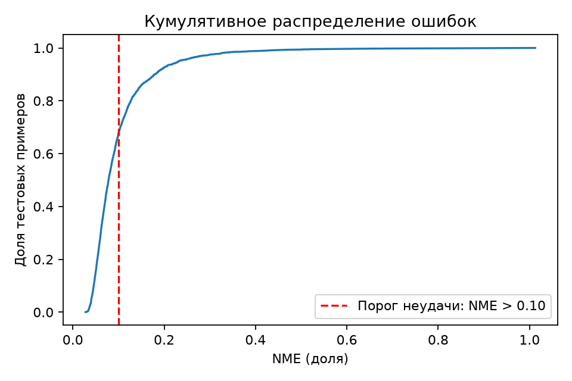
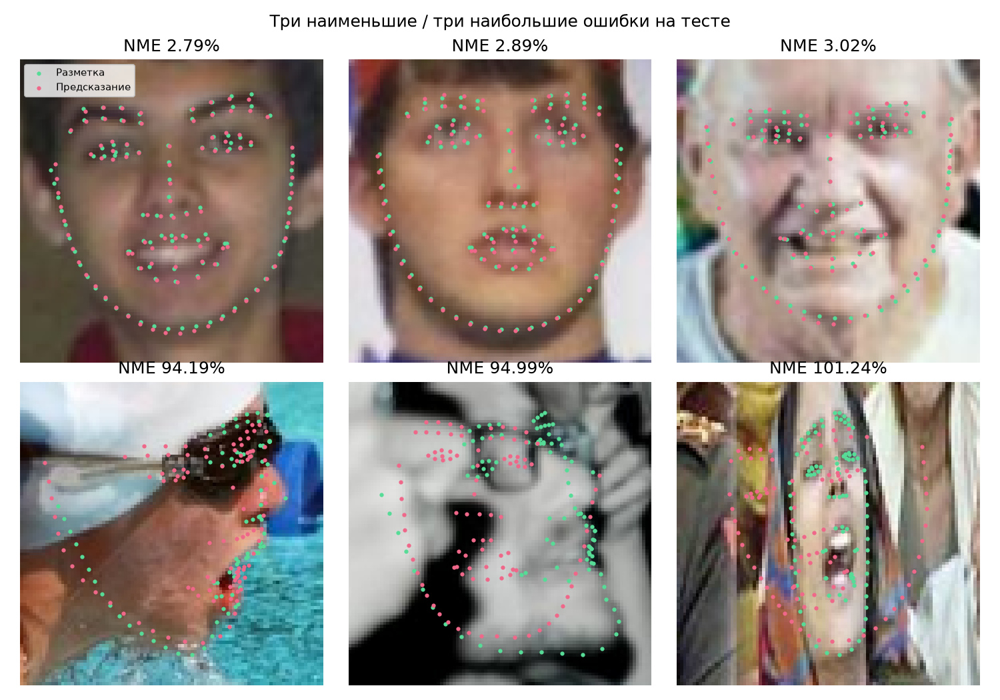

# FaceMetrics AI: исследовательский отчёт

## Цель и данные

CNN, обученная со случайной инициализацией, локализует лицевые ориентиры. Далее детерминированная геометрия переводит координаты в измерения. Рейтинг привлекательности, распознавание личности и медицинская интерпретация не являются задачами.

Набор: **wflw**, внутренний ключ протокола `official`: официальный test сохранён, обучающая выборка изменена для исключения пересечений. Train / validation / test: **4951 / 868 / 2500**. Уникальных RGB-снимков: **6551**. Исключено development-лиц из-за совпадения снимка с test: **1681**.

Хеш manifest: `1a6361e710a25828d15402b0bf26a9151645e18425bbd1380abeb5696efb49e8`. Seed: 42. Test сохраняется; совпадающие с ним снимки исключаются из development до обучения. Группировка идёт по декодированным пикселям. Независимость по людям не доказана; идентичности отсутствуют. [Источники и условия](DATASETS.md).

## Архитектуры и обучение

Обе CNN написаны на PyTorch без pretrained-энкодера. Регрессия: Conv/GroupNorm/SiLU 16→32→64→96, pooling 4×4, MLP 256→2N, sigmoid. Карты: энкодер 16→32→64, декодер со skip-соединениями, N карт 48×48, soft-argmax. Вход — RGB 96×96, нормировка RGB/127.5−1. Веса инициализированы случайно.

AdamW, lr=0.001, weight decay=0.0001, batch=32, CPU 4 потока. Аугментации: отражение с семантической перестановкой точек, ±12° поворота, 0.94–1.06 масштаба, ±2.5% переноса, яркость/контраст, слабое размытие. Регрессия использует Smooth L1; heatmap-модель дополнительно KL к Gaussian-разметке. Абсолютные loss разных архитектур несопоставимы.

| Архитектура | Параметры | Проверено эпох/частей эпох | Лучший validation NME | Время эпох |
|---|---:|---:|---:|---:|
| coordinates | 654,772 | 30 | 7.537% | 327.5 с |
| heatmaps | 135,698 | 11 | 8.152% | 604.2 с |

Ограничение запуска — 10 минут на каждую архитектуру; цикл может закончиться неполной эпохой, это отмечено в CSV. Начальная загрузка и завершающая валидация учитываются отдельно. Архитектура и checkpoint выбраны **только по минимуму validation NME**. Выбрана `coordinates`. Test использован после выбора; результаты других test-моделей для выбора не рассчитывались. Один seed, без оценки межзапусковой дисперсии. Сравниваются два конкретных ограниченных запуска: число эпох и фактическое время различаются. Это не доказательство универсального превосходства одной архитектуры.

## Результат на отложенной выборке

| Показатель | Фактическое значение |
|---|---:|
| Лиц на test | 2500 |
| Средний NME | 10.098% |
| Медианный NME | 7.819% |
| 90-й процентиль NME | 17.891% |
| Средняя локализация в исходном фото | 5.114 пикс. |
| Failure Rate, NME > 0.10 | 32.320% |

Средний шаблон, вычисленный только из train-разметки: **39.008% NME**. Предсказания нейросети, сопоставленные другим тестовым фото: **51.789% NME**. Первое сравнение проверяет преимущество перед постоянной формой; второе — зависимость качества от соответствия изображению.

Нормировка: WFLW — расстояние между размеченными зрачками 96–97; 300-W — между размеченными внешними уголками 36–45. В JSON NME хранится долей, в таблице — процентами. Процент NME не является процентом неправильных точек или вероятностью правильного ответа. AFW и WFLW имеют разные знаменатели NME.

## Влияние координат на измерения

Для каждого test-лица одна и та же формула применяется к предсказанным и размеченным точкам; затем вычисляется абсолютная разница. Ошибки ниже получены из реальных предсказаний:

| Показатель | Средняя абсолютная ошибка | 90-й процентиль ошибки | Валидных сравнений |
|---|---:|---:|---:|
| eye_tilt_0 | 4.1289 ° | 8.5817 ° | 2500 |
| eye_tilt_1 | 4.0752 ° | 8.3565 ° | 2500 |
| eye_aspect_0 | 6.3713 отношение | 2.7385 отношение | 2496 |
| eye_aspect_1 | 5.7167 отношение | 2.7644 отношение | 2495 |
| jaw_width | 0.0368 отношение | 0.0759 отношение | 2500 |
| eye_spacing | 0.2576 отношение | 0.5338 отношение | 2500 |
| midface_pupils | 0.0927 отношение | 0.2034 отношение | 2500 |
| mouth_nose | 0.2953 отношение | 0.6066 отношение | 2500 |

Это не индивидуальный доверительный интервал. Даже небольшой общий NME не гарантирует точный наклон уголков глаза. Если величина измеренного эффекта сопоставима с ошибкой, вывод по этому эффекту ненадёжен. При вырожденных отрезках некоторые отношения возвращают null, а число валидных сравнений уменьшается. У W/H встречаются очень большие выбросы при почти закрытом глазе: поэтому средняя абсолютная ошибка может быть выше 90-го процентиля. Значения не обрезались ради улучшения метрики; эта характеристика особенно нестабильна.

## Удачные и неудачные примеры

Примеры выбраны автоматически по test NME после фиксации модели: три наименьшие и три наибольшие ошибки. Это иллюстрации диапазона поведения, не ручной отбор только удачных лиц. Зелёные точки — исходная разметка; красные — фактический выход CNN. В показанных тяжёлых случаях видны профильный ракурс, перекрытия и малое разрешение. Список всех ошибок и имён снимков: `run/test_errors.json`.

## Ограничения и вывод

Это учебная компактная CNN с ограниченным временем обучения и входом 96×96. Не доказана точность для тонких различий внешности, новых камер, демографических групп или произвольных пользовательских снимков. Для содержательного улучшения нужны заранее спланированные более длительные эксперименты, большая разрешающая способность для глаз и отдельный внешний тест, а не подбор по уже просмотренному test.

Нейросеть обучается на GT-derived crop; пользователь выделяет область вручную. Ошибка кадрирования меняет результат. Внекадровые метки сохраняются с отражающим padding. Наличие лица не классифицируется: на произвольном объекте CNN также вернёт координаты; это не означает распознавание лица.

Яркость, контраст и резкость — эвристики качества. Два реальных forward pass дают расхождение при отражении; это проверка стабильности, не откалиброванная уверенность. Поворот головы, перспектива и мимика искажают плоские расстояния. Полноценные facial thirds, анатомический bigonial/bizygomatic ratio, профильный gonial angle и orbital vector недоступны по этой разметке.

Математика воспроизводима **для данных координат**, но не превращает их в объективную оценку привлекательности или трёхмерную анатомию. Проверка на новых добровольческих фотографиях с разрешением владельцев и аппаратная проверка камеры остаются отдельными задачами; текущая количественная оценка выполнена на реальных снимках исследовательского датасета.

Полные формулы и покрытие ориентиров: [MEASUREMENTS.md](MEASUREMENTS.md). Технические проверки: [VALIDATION.md](VALIDATION.md). Происхождение веса и тестовые метрики также сохранены в JSON рядом с checkpoint.
